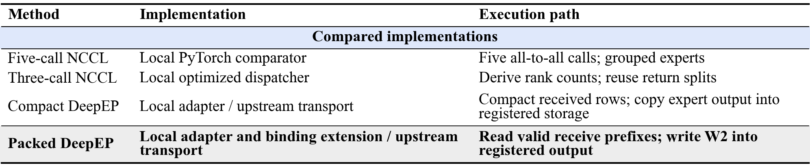
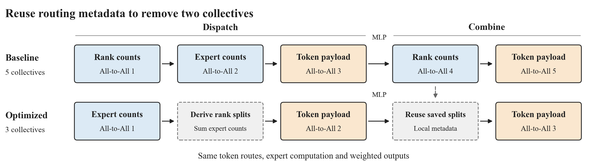
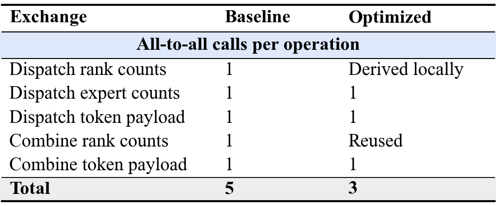
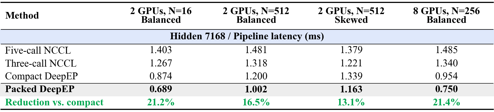
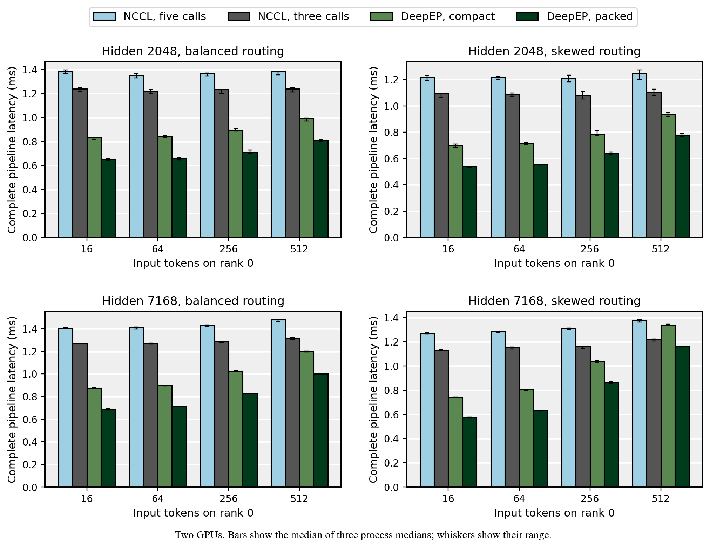
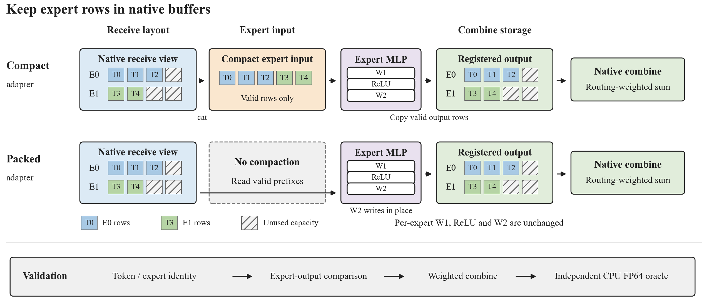
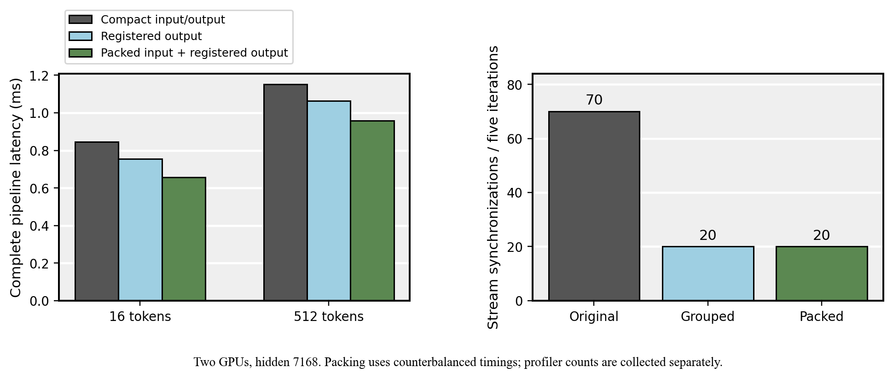
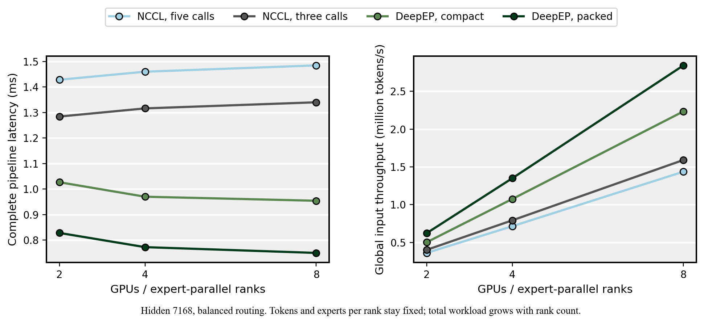
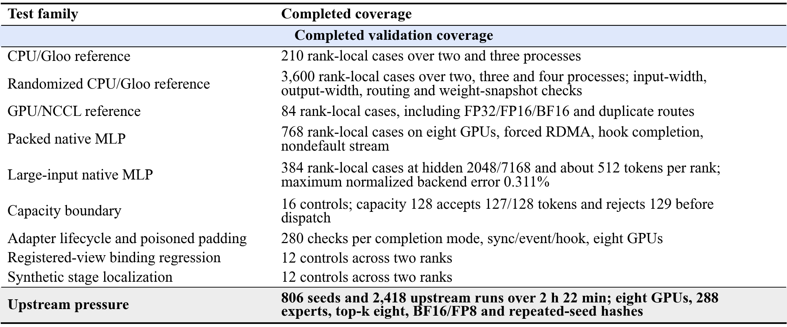

## Expert-Parallel MoE Dispatch and Combine Optimization on H100

All-to-all metadata exchanges and adapter-side synchronization add latency to expert-parallel MoE execution. I implemented a three-collective PyTorch path, a packed DeepEP adapter, and a C++ binding extension for direct registered-buffer input. Complete pipeline latency fell by **7.7%–13.2%** versus the five-collective PyTorch baseline and **13.1%–23.7%** versus the compact DeepEP adapter across the measured 2/4/8-GPU grid.

## Code map

Start with [dispatch.py](moe_lab/dispatch.py) for the five-call and three-call PyTorch paths, then [deepep_backend.py](moe_lab/deepep_backend.py) for the compact and packed native adapters.

```text
moe_lab/dispatch.py                  PyTorch routing, split reuse and weighted combine
moe_lab/deepep_backend.py             Native buffers, completion and context lifecycle
moe_lab/expert_mlp.py                Grouped and registered-output expert computation
moe_lab/diagnostics.py               Stage errors and first-failure localization
patches/                            C++ binding patch and upstream license
scripts/benchmark_pipeline.py       Counterbalanced complete-pipeline measurements
scripts/validate_deepep.py           Identity alignment and independent FP64 checks
scripts/validate_zero_copy_contract.py  Binding and buffer-state regression controls
results/                            Aggregated measurements and required build identity
```

## Implementations

I implemented the PyTorch comparators, native adapters, expert workload, benchmark harness and numerical validation. The five-exchange reference follows an all-to-all dispatch/combine exercise. Native communication kernels come from [DeepEP v1.2.1](https://github.com/deepseek-ai/DeepEP/tree/9af0e0d0e74f3577af1979c9b9e1ac2cad0104ee); the local C++ patch extends its zero-copy binding.



The two improvements are measured separately. Three-call NCCL changes the PyTorch communication schedule; packed DeepEP changes the data layout around the upstream native transport. All four methods use the same grouped BF16 expert MLP. Both DeepEP variants use the same patched binary and registered zero-copy combine storage.

## Communication



My three-call dispatcher derives incoming rank counts from exchanged expert counts and reuses the dispatch splits for return traffic. This reduces a complete dispatch/combine path from five collectives to three without changing routing or expert computation.



## Registered-buffer binding

While connecting the packed expert path, I found that the pinned C++ binding rejected the padded, noncontiguous view returned by DeepEP's own registered-buffer getter. I extended the binding to accept that view in zero-copy mode after checking its registered pointer and exact strides, before the alternating-buffer index changes.

The patch preserves the existing contiguous-placeholder convention. Twelve regression controls cover invalid views, buffer-index preservation, a valid call after rejection and legacy compatibility. This is a local API extension to the pinned version; the native communication kernels are unchanged.

[Read the C++ patch](patches/deepep-v1.2.1-zero-copy-layout.patch), [binding regression tests](scripts/validate_zero_copy_contract.py).

## Results

The three-collective reference reduced complete pipeline latency by **7.7%–13.2%** against the five-collective baseline across the measured grid. The packed native path reduced latency by **13.1%–23.7%** against the compact DeepEP adapter in three fresh process launches at each of two, four and eight H100 GPUs.



Each value is the median of three process-level medians. All methods include dispatch, the same BF16 expert MLP and weighted combine. Here N is the input token count on rank zero; rank r receives N + 3r tokens. Each rank owns four experts, top-k is two, and the expert intermediate width is 128. The grid uses hidden widths 2048 and 7168. Width 7168 matches the [DeepSeek-V3 hidden dimension](https://huggingface.co/deepseek-ai/DeepSeek-V3/blob/main/config.json); the benchmark uses a compact two-layer expert workload rather than the full model.

Measurements use one Nebius host with eight H100 SXM GPUs, NV18 connectivity across all GPU pairs and eight active 400 Gb/s NDR InfiniBand ports. The main latency grid permits NVLink; forced-RDMA checks are reported separately. [GPU transport checks](scripts/validate_gpu_links.py).



Bars show complete-operation latency; whiskers span the three process medians. Aggregated values and process medians are in [measurements.json](results/measurements.json).

## Buffer layout and profiling



Token colors identify expert groups; hatched cells indicate unused capacity.

I profiled repeated synchronization and materialization around the native transport. Reusing known output sizes and expert counts removed redundant host waits. Computing directly from the expert-major receive view and writing the final expert GEMM into registered combine storage then removed receive compaction and output repacking.



Native `cudaStreamSynchronize` calls fell from 70 to 20 over five profiled iterations. Against the grouped compact path, the packed path retains 20 calls while reducing `aten::copy_` from 75 to 30 and `aten::cat` from five to zero. Ablation timings and profiler counts come from separate runs.

## Numerical debugging

I aligned dispatch rows by token and expert identity before comparison. Distinct expert weights, biases and nonuniform routing weights expose errors that identity experts would hide. Stage reports compare dispatch, expert output and weighted combine, followed by an independent CPU FP64 oracle.

Controlled faults verify that corrupted tokens fail at dispatch, wrong expert matrices and NaNs fail at expert computation, and corrupted output order or routing weights fail at combine. Empty ranks, globally empty batches and dropped routes are exercised separately.

## Rank scaling



The workload grows with rank count. Tokens and experts per rank stay approximately fixed while global tokens and total experts increase. Measurements use one eight-GPU host; large skewed workloads concentrate computation on two experts and reduce the advantage of native transport.

## Run

The validated stack uses PyTorch 2.7.1+cu126, CUDA compiler 12.8.93, NCCL 2.26.2, NVSHMEM 3.3.9 and DeepEP v1.2.1. The validated dependency lock is maintained separately from this repository. Set `REQUIREMENTS_LOCK` to its external file path before running the GPU setup script.

```bash
bash scripts/setup_gpu_environment.sh
source scripts/gpu_environment.sh
export CUDA_VISIBLE_DEVICES=0,1
.venv/bin/python -m scripts.validate_distributed --backend nccl --world-size 2 --output results/nccl-new.json
.venv/bin/torchrun --standalone --nproc_per_node=2 -m scripts.validate_deepep \
  --packed-experts --packing zero_copy --known-output-size \
  --completion event --stream non_default --output results/deepep-new.json
```

Use a fresh output path for each run. Native execution requires the verified NVSHMEM/IBGDA environment in addition to the GPU topology. The native build requires matching Python 3.12 development headers and the CUDA 12.8 toolkit.

## Validation



Case counts include individual ranks. Test families use different workloads and are reported separately. The upstream test covers its BF16/FP8 and zero-copy variants; the independent expert MLP oracle covers the adapter path.

## License

Original contributions are Copyright (c) 2026 Lucia Huang and licensed under the [MIT License](LICENSE). Third-party code retains its original copyright and license notices; see [DeepEP attribution](patches/README.md) and its [MIT license](patches/DEEPEP-LICENSE).
